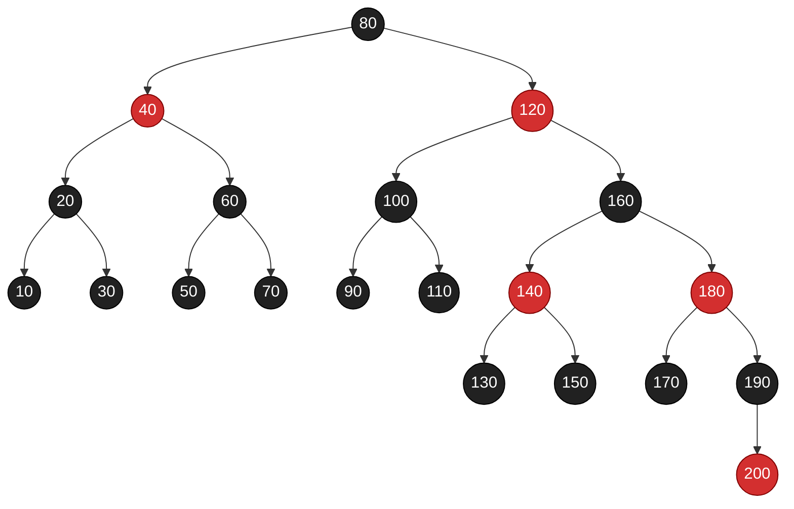

# Tarea #6: Árboles y Grafos

Programación III, UTEC 2026-2
Alumno: Adrian Gabriel Rojas Tejada Código: 202510038

## Contenido

| Archivo | Problema |
|---|---|
| `p1.cpp` | Ejercicio 1: BST iterativo y análisis de degradación |
| `p2.cpp` | Problema 2: Red-Black Tree y comparación con el BST |
| `p3.cpp` | Problema 3: DFS iterativo (camino raíz-hoja con suma K) |
| `p4.cpp` | Problema 4: BFS iterativo (árbol completo, ancho máximo, profundidad mínima) |

Todo es **iterativo** (sin recursión). Cada archivo tiene su propio `main` que prueba las operaciones.

## Compilación y ejecución

```bash
cmake -S . -B build
cmake --build build
./build/p1   # o p2, p3, p4
```

También se pueden abrir en CLion y elegir `p1`, `p2`, `p3` o `p4` en el selector de ejecución.

**Convención de altura:** número de nodos en el camino más largo de la raíz a una hoja (árbol vacío = 0, un solo nodo = 1).

---

## Ejercicio 1: BST iterativo y degradación

**Implementado:** inserción iterativa, eliminación iterativa (casos de 0, 1 y 2 hijos usando el sucesor in-order), recorrido in-order con `std::stack`, altura iterativa y pre-orden iterativo.

**Prueba pedida:** se insertan 20 elementos (10, 20, ..., 200), se eliminan 2 (el 50 y el 200), se recorre in-order y se calcula la altura.

| Medición | Resultado |
|---|---|
| Comparaciones al insertar 20 datos ordenados | 190 = 20·19/2 |
| Altura tras insertar | 20 |
| Altura tras eliminar 50 y 200 | 18 |
| In-order final | 10 20 30 40 60 70 80 90 100 110 120 130 140 150 160 170 180 190 |

Una segunda prueba con un árbol no degenerado valida la eliminación de un nodo con dos hijos y de la raíz.

### Por qué la complejidad puede degradarse a O(n)

1. Insertar, buscar y eliminar recorren un camino desde la raíz, así que cuestan $O(h)$, donde $h$ es la altura.
2. **Existe una entrada con $h = n$.** Sean $k_1 < k_2 < \dots < k_n$ insertadas en ese orden. Por inducción sobre $i$, tras insertar $k_i$ el árbol es una cadena hacia la derecha cuyo último nodo es $k_i$:
   - *Base:* con $k_1$ el árbol es un solo nodo.
   - *Paso:* como $k_{i+1} > k_i$ y $k_i$ es mayor que todas las claves anteriores, $k_{i+1}$ va a la derecha en cada comparación hasta llegar al hijo derecho vacío de $k_i$. La cadena crece en un nodo.

   Por lo tanto $h(n) = n$.
3. **Costo total.** Insertar $k_i$ hace $i-1$ comparaciones, así que $n$ inserciones cuestan
   $$\sum_{i=1}^{n}(i-1) = \frac{n(n-1)}{2} = \Theta(n^2)$$
   y cada operación individual cuesta $\Theta(n)$.
4. **Contraste.** Un árbol binario de altura $h$ tiene a lo más $2^h - 1$ nodos, luego $h \ge \lceil \log_2(n+1) \rceil$. Para $n = 20$ el mínimo posible es 5, pero el BST con datos ordenados llega a 20.

### Complejidad de las operaciones (BST)

| Operación | Mejor caso (balanceado) | Peor caso (cadena) |
|---|---|---|
| Insertar / eliminar | $O(\log n)$ | $O(n)$ |
| In-order / pre-orden | $O(n)$ | $O(n)$ |
| Altura | $O(n)$ | $O(n)$ |

---

## Problema 2: Red-Black Tree

**Implementado:** rotación izquierda, rotación derecha, recoloración, corrección de incumplimientos tras insertar (3 casos y sus simétricos), altura, pre-orden con colores y el método `verificar()`.

Se usa un nodo centinela negro para todas las hojas nulas, por lo que la propiedad 5 se cumple por construcción.

### Verificación formal de propiedades

`verificar()` recorre el árbol (iterativamente, con `std::stack`) y comprueba:

| Propiedad | Cómo se verifica |
|---|---|
| 1. Cada nodo es rojo o negro | Garantizada por el tipo `enum Color` |
| 2. La raíz es negra | Se comprueba el color de la raíz |
| 3. Un nodo rojo no tiene hijo rojo | Se revisan los hijos de cada nodo rojo |
| 4. Mismo número de negros en todo camino a una hoja nula | Se lleva el conteo de negros y se compara en cada hoja nula |
| 5. Las hojas nulas son negras | El centinela es negro |

Además comprueba el orden BST y la coherencia de los punteros al padre. Se ejecutó tras **cada una** de 2000 inserciones aleatorias y las propiedades se cumplieron siempre.

### Comparación BST vs Red-Black Tree (20 datos ascendentes)

| Estructura | Altura |
|---|---|
| BST (Ejercicio 1) | **20** |
| Red-Black Tree | **6** (altura negra 3, 14 rotaciones, 67 recoloraciones) |

Experimento con $n$ claves ascendentes:

| n | BST | RBT | Cota $2\log_2(n+1)$ |
|---|---|---|---|
| 20 | 20 | 6 | 8.78 |
| 100 | 100 | 11 | 13.32 |
| 1000 | 1000 | 17 | 19.93 |
| 10000 | 10000 | 24 | 26.58 |

### Pre-orden de los árboles (para graficar)

**BST:** `10 20 30 40 50 60 70 80 90 100 110 120 130 140 150 160 170 180 190 200`
Es una cadena: cada nodo tiene solo hijo derecho, altura 20.

**Red-Black Tree** (R = rojo, B = negro):
`80B 40R 20B 10B 30B 60B 50B 70B 120R 100B 90B 110B 160B 140R 130B 150B 180R 170B 190B 200R`



(En el diagrama, el nodo 200 es hijo derecho de 190.)

### Por qué la altura es $O(\log n)$

Sea $bh(x)$ la altura negra: cantidad de nodos negros en un camino de $x$ a una hoja nula, contando a $x$ si es negro (es la misma para todos los caminos por la propiedad 4).

**Lema.** El subárbol con raíz $x$ tiene al menos $2^{bh(x)} - 1$ nodos internos.

*Demostración por inducción sobre la altura de $x$.*
- *Base:* si $x$ es hoja nula, $bh = 0$ y $2^0 - 1 = 0$ nodos. Se cumple.
- *Paso:* cada hijo $c$ de $x$ cumple $bh(c) \ge bh(x) - 1$ (igual a $bh(x)$ si $x$ es rojo, $bh(x)-1$ si es negro). Por hipótesis cada hijo tiene al menos $2^{bh(x)-1} - 1$ nodos. Entonces el subárbol de $x$ tiene al menos $1 + 2\,(2^{bh(x)-1} - 1) = 2^{bh(x)} - 1$ nodos. $\square$

**Teorema.** $h \le 2\log_2(n+1)$.

*Demostración.* Sea $h$ la altura (en nodos). Por la propiedad 3 no hay dos rojos consecutivos en un camino, y la raíz es negra (propiedad 2), así que al menos la mitad de los nodos del camino más largo son negros: $bh(\text{raíz}) \ge h/2$. Por el lema,
$$n \ge 2^{bh(\text{raíz})} - 1 \ge 2^{h/2} - 1 \;\Rightarrow\; h \le 2\log_2(n+1) = O(\log n). \quad \square$$

### Complejidad de la inserción en el RBT

- Bajar hasta la posición de inserción: $O(h) = O(\log n)$.
- Corrección: cada vuelta del bucle recolorea en $O(1)$ y sube un nivel, a lo más $h$ vueltas; las rotaciones son $O(1)$ y hay a lo más 2 por inserción.
- **Total: $O(\log n)$ por inserción.** Frente al $\Theta(n)$ por inserción del BST con datos ordenados.

| Operación | Complejidad |
|---|---|
| Insertar | $O(\log n)$ |
| Rotación | $O(1)$ |
| Altura | $O(n)$ |
| `verificar()` | $O(n)$ |

---

## Problema 3: DFS iterativo

**Implementado:** `caminoConSuma(root, K)` devuelve si existe un camino raíz-hoja con suma $K$ y el camino. Usa **solo `std::stack`** y no usa recursión.

**Funcionamiento:** DFS en post-orden iterativo. La pila guarda exactamente el camino actual (de la raíz al nodo en que se está) y se mantiene la suma de ese camino:
- al bajar a un nodo se apila y se suma su valor;
- al terminar un nodo se desapila y se resta su valor (backtracking);
- si el nodo que se va a desapilar es hoja y la suma vale $K$, la pila es el camino buscado.

**Pruebas:** un árbol con caminos de suma 27, 22, 26 y 18 (casos que existen y que no, incluyendo K = 5, que no es camino raíz-hoja), un árbol con valores negativos, un solo nodo y un árbol vacío.

### Por qué DFS es adecuado

1. Un camino raíz-hoja es una cadena de nodos, y el DFS mantiene en la pila justo el camino actual. La suma se actualiza en $O(1)$ al entrar o salir de un nodo, sin recalcularla.
2. **Invariante:** al inicio de cada vuelta, la pila contiene los nodos de la raíz al nodo actual y `suma` es la suma de sus valores. Al llegar a una hoja, la pila contiene un camino raíz-hoja completo y `suma` es su suma, que es lo que se compara con $K$.
3. **Tiempo $O(n)$:** cada nodo se apila una vez, se desapila una vez y se mira como tope a lo más dos veces (antes y después de su hijo derecho).
4. **Memoria $O(h)$:** la pila nunca tiene más nodos que la altura. BFS necesitaría guardar la suma parcial y el camino de cada nodo del nivel, es decir $O(n)$ en el peor caso.
5. Con valores negativos no se puede podar cuando la suma se pasa de $K$ (un valor negativo posterior podría compensarla), por eso en el peor caso se revisan todos los caminos.

---

## Problema 4: BFS iterativo

**Implementado** (solo `std::queue`, sin recursión):
- `esCompleto`: recorre por niveles encolando también los hijos nulos; si tras un nulo aparece un nodo real, no es completo.
- `anchoMaximo`: `q.size()` al empezar cada nivel es la cantidad de nodos de ese nivel.
- `profundidadMinima`: se corta en la primera hoja encontrada.

**Definiciones:** *completo* = todos los niveles llenos salvo quizá el último, que se llena de izquierda a derecha (el árbol vacío se considera completo). *Ancho* = mayor cantidad de nodos en un nivel. *Profundidad mínima* = nodos del camino más corto de la raíz a una hoja.

**Pruebas:** 8 árboles (perfecto, completo con último nivel incompleto, tres no completos distintos, un nodo, vacío y cadena), cada uno comparado con el resultado calculado a mano. Los 8 coinciden.

### Justificación formal de por qué BFS es el enfoque natural

**Lema (orden por niveles).** Al inicio de cada iteración del bucle por niveles, la cola contiene exactamente los nodos de profundidad $d$, de izquierda a derecha.
*Demostración por inducción sobre $d$.* Para $d=1$ la cola contiene solo la raíz. Si contiene exactamente los nodos de profundidad $d$, al procesarlos se desencolan todos y se encolan sus hijos, que son exactamente los nodos de profundidad $d+1$, en el mismo orden. $\square$

Consecuencias:
1. **Ancho máximo.** Por el lema, `q.size()` al empezar cada nivel es el número de nodos de ese nivel. El máximo de esos valores es el ancho del árbol.
2. **Profundidad mínima.** Por el lema, BFS visita los nodos en orden no decreciente de profundidad, así que la primera hoja encontrada tiene la menor profundidad posible y se puede cortar de inmediato. DFS tendría que explorar todo el árbol para asegurar el mínimo.
3. **Árbol completo.** Numerando los nodos en forma de heap (la raíz es 1, los hijos de $i$ son $2i$ y $2i+1$), un árbol es completo si y solo si sus nodos ocupan las posiciones $1, \dots, m$ sin huecos. El recorrido por niveles con nulos enumera las posiciones $1, 2, 3, \dots$ en ese orden, así que el árbol es completo si y solo si no aparece un nodo real después de un nulo.

**Complejidad:** cada nodo entra y sale de la cola una vez, así que el tiempo es $O(n)$. La memoria es $O(w)$, con $w$ el ancho máximo del árbol (hasta $\approx n/2$ en un árbol perfecto).

| Función | Tiempo | Espacio |
|---|---|---|
| `esCompleto` | $O(n)$ | $O(w)$ |
| `anchoMaximo` | $O(n)$ | $O(w)$ |
| `profundidadMinima` | $O(n)$ en el peor caso (puede cortar antes) | $O(w)$ |

---

## Resumen de complejidades

| Estructura / algoritmo | Operación | Complejidad |
|---|---|---|
| BST | insertar, eliminar | $O(h)$, hasta $O(n)$ |
| Red-Black Tree | insertar | $O(\log n)$ |
| DFS (camino con suma $K$) | tiempo / espacio | $O(n)$ / $O(h)$ |
| BFS (completo, ancho, profundidad mínima) | tiempo / espacio | $O(n)$ / $O(w)$ |
